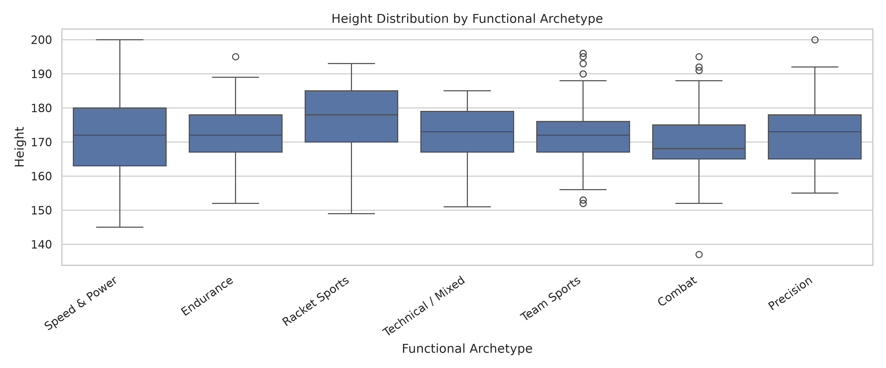
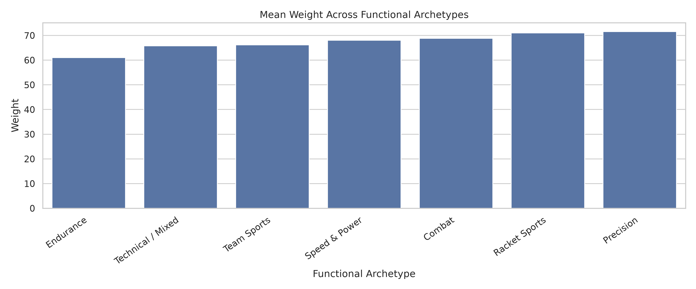

# Question 1 — Descriptive Athlete Profiles Across Sport Archetypes

[← Project overview](../README.md) · [Full Q1 report](report.pdf)

## Research question

**How do age, height and weight distributions vary across broad sporting categories and Athletics sub-disciplines, with comparisons by sex where sample sizes permit?** BMI and the seven project-defined functional archetypes are also analyzed.

## Data and analysis unit

- Input: the cleaned event-level dataset (`data_read_to_use.csv`, copied from `../cleaning/`).
- Derived features: **BMI = Weight (kg) / [Height (cm) / 100]²** and `Archetype`, assigned using `Sport` and, where needed, `Event` (especially Athletics, Swimming and Cycling).
- For primary Q1 summaries, retain one record per **(ID, Year, Archetype)**: **737 observations** across **522 unique athlete IDs** (not 737 different people).
- Athletics sub-discipline comparisons use the event-level input and deduplicate within `(ID, Year, Discipline)` rather than relying solely on the archetype-compressed table.

## Findings

- **Team Sports** is the largest group: **245 / 737 observations (33.2%)**.
- **Precision** has the highest average age (approximately **29.21 years**).
- **Racket Sports** has the highest average height (approximately **176.66 cm**).
- **Endurance** has the lowest average weight (approximately **61.04 kg**) and lowest average BMI.

These are sample descriptions. Group sizes differ, athletes can appear in more than one edition/archetype, and BMI does not directly measure body-fat percentage.

## Notebooks and artifacts

| File | Role |
| --- | --- |
| `data_for_q1.ipynb` | Loads cleaned data; prepares BMI/working data |
| `classification.ipynb` | Applies sport/event-to-archetype mapping and writes `q1_working.csv` |
| `stats.ipynb` | Calculates overall, archetype, sex-wise and mean-comparison tables |
| `plotting.ipynb` | Produces comparisons and distribution visualizations |
| `q1_working.csv` | Athlete-event working data with derived BMI and archetype |
| `q1_archetype_counts.csv`, `q1_mean_comparison.csv` | Aggregate group tables |
| `q1_overall_statistics.csv`, `q1_sexwise_statistics.csv` | Descriptive statistics |
| `q1_plots/` | Exported histograms, boxplots, sex-wise plots, mean comparisons, and scatterplots |
| `report.pdf`, `report.tex` | Detailed write-up and its LaTeX source |

## Run locally

From the repository root, after installing dependencies described in the [main README](../README.md):

```bash
cd Question-1
cp ../cleaning/data_read_to_use.csv .   # only if absent
jupyter lab
```

Execute `data_for_q1.ipynb` first, then `classification.ipynb`, followed by `stats.ipynb` and `plotting.ipynb`. Paths are relative to this directory. `classification.ipynb` updates `q1_working.csv`, so downstream notebooks should be run afterward.

To rebuild the LaTeX report, you can run `make` in this folder if `pdflatex` is installed. **Caution:** `make clean` also deletes PDF files in this directory; use `make cleantemp` to remove only temporary LaTeX files.

## Example visualizations




The full methodology, Athletics-specific breakdown, sample sizes and limitations are in [report.pdf](report.pdf).
