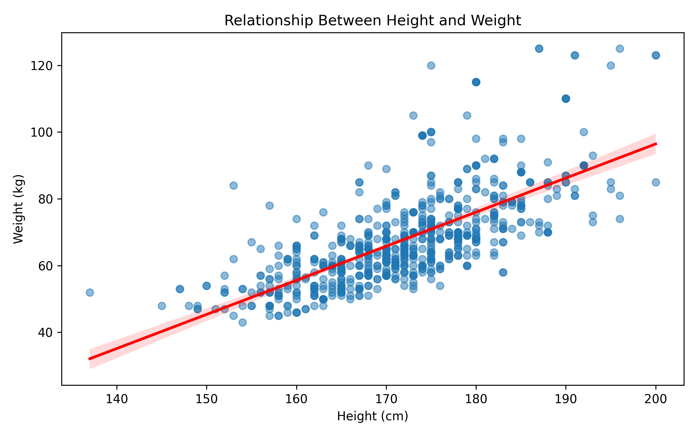

# Question 2 — Height–Weight Regression Across Sport Archetypes

[← Project overview](../README.md) · [Full Q2 report](question2-report.pdf)

## Research question

**Does the association between height and weight differ across functional sport archetypes after accounting for sex?** The goal is to test whether one pooled height–weight line adequately describes different types of athletes.

## Models and methods

- **Height-only baseline:** `Weight ~ Height` (ordinary least squares).
- **Extended model:** includes centered height, recorded sex, archetype indicators, and **height × archetype interactions**. Endurance is the archetype reference; the interaction terms permit archetypes to have different height slopes.
- Compare baseline and extended fitted models on the **same common sample**; use a nested-model partial **F-test** of the height × archetype terms.
- Inspect residuals by archetype, residuals-versus-fitted plots and Q–Q diagnostics.
- Make an **athlete-ID-grouped 80:20 holdout split** and calculate individual **95% OLS prediction intervals** for held-out records.

## Data and key results

- **732 athlete–year observations** before filtering multi-archetype athlete-years; **5** ambiguous multi-archetype rows are excluded, giving **727** common model observations.
- **Pearson correlation:** **r ≈ 0.698** for height and weight in the 732-record dataset.
- **Baseline in-sample R²:** approximately **0.487**; **extended in-sample R²:** approximately **0.576** on the common sample.
- Height-only residuals show systematic archetype patterns (for example, Endurance has a negative average residual), supporting the need to model sport composition. The report discusses the formal interaction test.

R² is an **in-sample description**, not a claim of held-out prediction accuracy. Conventional OLS prediction intervals here are not athlete-cluster-adjusted; non-normality and heteroskedasticity may affect coverage.

## Files

| File | Role |
| --- | --- |
| `Q2_regression_analysiss.ipynb` | End-to-end cleaning of analysis units, regression fitting, tests, plots, athlete-grouped holdout and prediction intervals |
| `q2_athlete_year_level.csv` | Athlete-year level extract; accepted notebook input |
| `q2_athlete_level_review.csv`, `q2_multiple_archetypes.csv` | Review/diagnostics for records with more than one archetype |
| `q2_test_predictions_with_intervals.csv` | Saved held-out predictions and bounds |
| `plots/` | Committed regression and diagnostics figures |
| `question2-report.pdf` | Interpretations, full results and limitations |

## Run locally

```bash
cd Question-2
cp ../Question-1/q1_working.csv .    # preferred input for full Q1-to-Q2 provenance
jupyter lab
```

Run `Q2_regression_analysiss.ipynb` in order. Its input-loading cell searches for `q1_working.csv`, `q1_working(1).csv`, then `q2_athlete_year_level.csv` **in the current working directory**. The repository already includes the third option, so the copy is optional for running the existing notebook, but useful when reproducing the Q1-to-Q2 flow.

**Output-path note:** The notebook writes new figures and prediction data under `q2_outputs/` (including `q2_outputs/plots/`); the committed `plots/` and CSVs at this question's root are already-exported artifacts. They do not automatically update when you run the notebook unless paths are changed.

## Example visualization



See [question2-report.pdf](question2-report.pdf) for coefficient tables, F-test conclusions, interpretation and cautions about observational data and repeated appearances.
